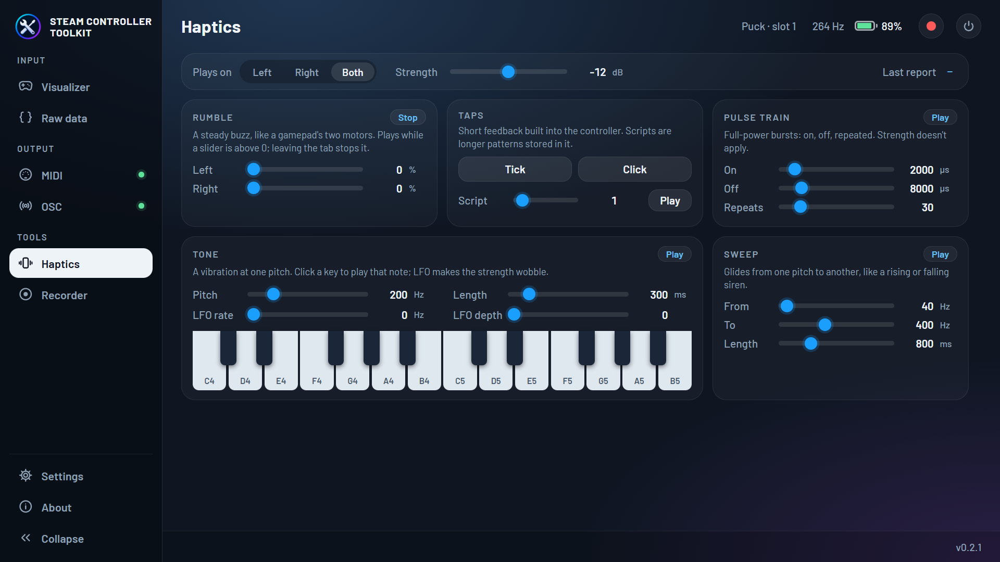
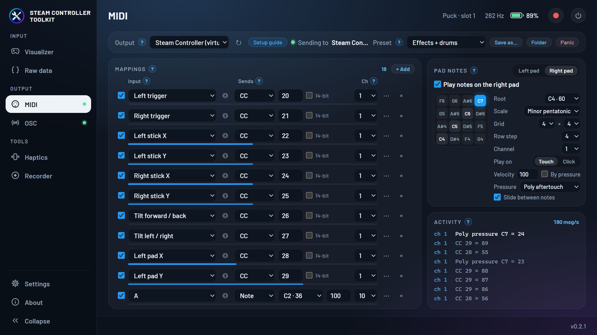
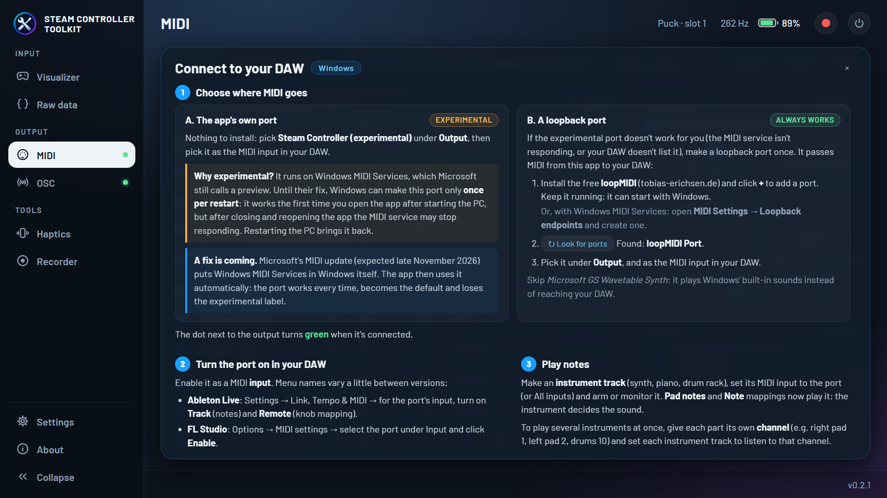
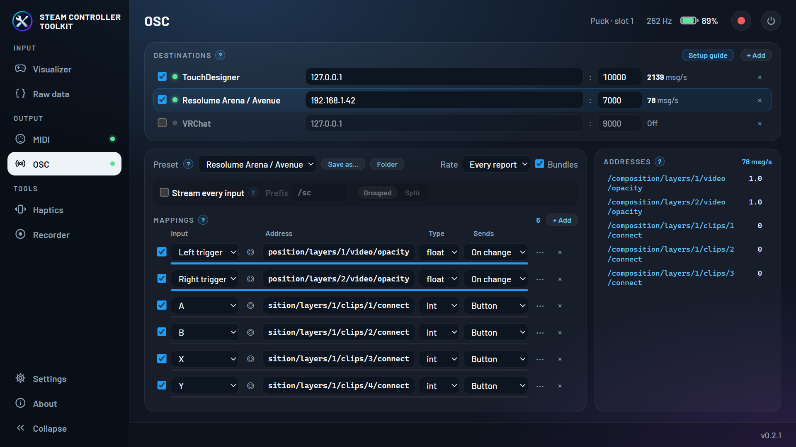
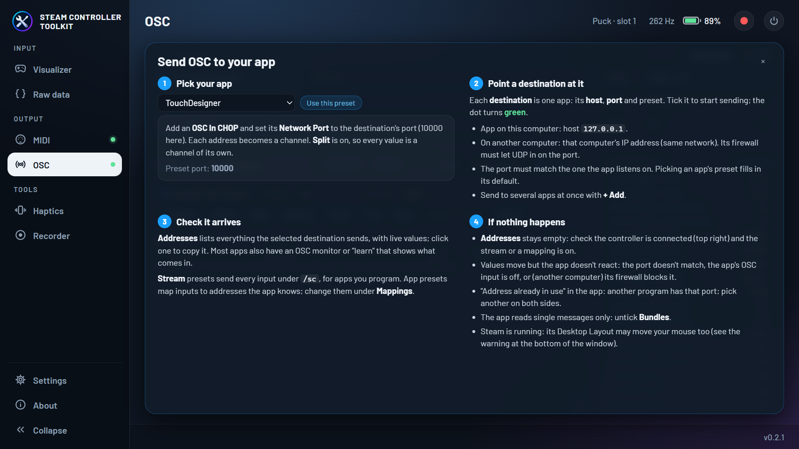
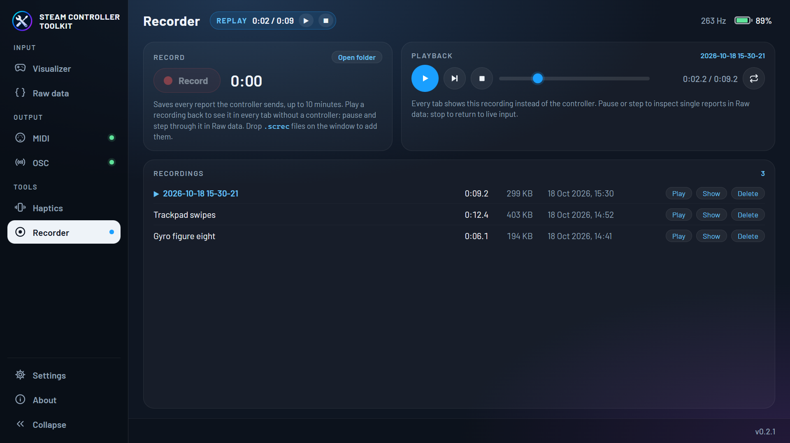
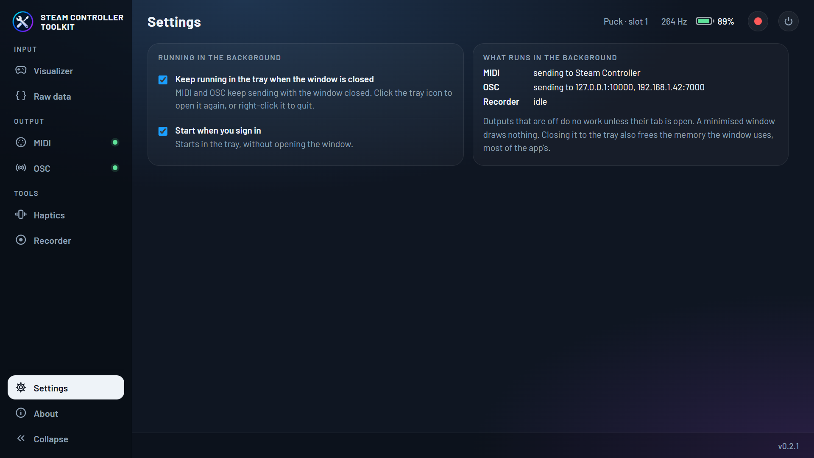

<p align="center">
  
</p>

<h1 align="center">Steam Controller Toolkit</h1>

<p align="center">
  A desktop app for exploring and tinkering with the 2026 Steam Controller.<br />
  Windows · macOS · Linux
</p>

<p align="center">
  <a href="https://www.youtube.com/watch?v=QCvgsTT6-FI">
    
  </a>
  <br />
  <sub>▶ <a href="https://www.youtube.com/watch?v=QCvgsTT6-FI">Watch the demo video on YouTube</a></sub>
</p>


## Features

The app talks to the controller directly over HID (no Steam or driver needed) and shows
everything it sends, live (~265 reports per second). It is organised in tabs, one per tool.

### Visualizer

- **3D controller** with every button, stick, trigger, trackpad, D-pad arm and back button
  moving and lighting up as you use it. The view rests front-facing; **hold the right trigger**
  (past 30%) and the model follows how you turn the controller, then eases back when you let go.
- **Pitch, roll and yaw** from the controller's own orientation sensor, with a *Re-center yaw*
  button (yaw has no absolute reference and drifts slowly).
- **Analog gauges**: trigger rings, stick positions and trackpad finger positions, with
  capacitive touch shown on the sticks and pads.
- **Motion graph**: the last 5 seconds of gyro, accelerometer, triggers or pad pressure, on
  fixed scales so past data never rescales. Hover it to read past values.
- **Buttons panel** laid out like the controller, including the L4/L5/R4/R5 back buttons and
  the grip, stick and pad touch sensors.

### Haptics

Play every haptic effect the controller supports, on the left, right or both actuators:

- **Rumble** with a slider for each motor.
- **Taps** (tick and click) and the 18 haptic scripts stored in the controller.
- **Tone** with frequency, duration and LFO, plus a two-octave **piano** to play notes.
- **Pulse trains** and **frequency sweeps**.
- The bytes of the last report sent, for protocol work.



### MIDI

Use the controller as a MIDI controller in your DAW (Ableton Live, FL Studio, Bitwig, Reaper,
Logic…), to move effect knobs or play notes:

- **Mappings**: any input (triggers, stick and trackpad axes, pad pressure, tilt, turn speed,
  every button) to a **CC** (7- or 14-bit), **pitch bend**, **aftertouch**, a **note** or a
  **program change**, on any channel. Each mapping has a range, deadzone, curve, smoothing,
  invert, toggle (latch) and an optional *only while a button is held* switch, so tilt can
  bend a filter only while you hold a back button. **Learn** picks the input: click it, then
  move or press a control.
- **Pad notes**: play either trackpad as a grid of notes (1×1 up to 8×8) in a scale, by touch
  or click, with sliding between notes and pad pressure as aftertouch.
- **Presets**: *Effects + drums* (the default), *Pad instrument* and *Effects only* are built
  in; save your own (plain JSON files in the app's data folder, easy to share).
- A live meter per mapping, the latest messages sent, and a *Panic* button for stuck notes.
- A recording that plays back drives MIDI too, so a take can be replayed into the DAW.
- A **Setup guide** for your system and DAW, and a **?** on every section that explains it.



**Where the MIDI goes**: the app makes its own **Steam Controller** MIDI port, the default
output; pick it as a MIDI input in your DAW and you're done.

- **macOS**: a CoreMIDI port, on every macOS version. Logic and GarageBand use it
  automatically; other DAWs list it as an input.
- **Linux**: an ALSA MIDI port (`aconnect -l` shows it). On PipeWire it reaches JACK apps too;
  on plain JACK, bridge it with `a2jmidid -e`.
- **Windows**: needs Windows 11 25H2 or later and uses
  [Windows MIDI Services](https://github.com/microsoft/MIDI), which Microsoft still calls a
  **preview**. Until its update (expected late November 2026), Windows makes the port only once
  per restart: it works the first time you open the app after starting the PC, but after
  reopening the app the MIDI service may stop responding until you restart the PC. So the MIDI
  tab offers it as **Steam Controller (experimental)**; it becomes a normal, default port by
  itself once Windows has the update. If the experimental port doesn't work for you, use a
  loopback port, which always works: create one with the free
  [loopMIDI](https://www.tobias-erichsen.de/software/loopmidi.html) (or Windows MIDI Services'
  *Loopback endpoints*), pick it as the output in the MIDI tab, and as an input in your DAW.



### OSC

Send the controller to anything that speaks [OSC](https://opensoundcontrol.stanford.edu/)
(Open Sound Control) over the network: visual and creative-coding tools, game engines, lighting
desks, VJ software, DAWs. Several apps can get it at once, on this computer or others.

- **Stream**: every input under a prefix (default `/sc`), nothing to set up:
  `/sc/left_stick x y`, `/sc/trigger_right v`, `/sc/button/a 1`, `/sc/left_pad x y`
  (while touched) plus `/pressure`, `/touch` and `/click`, `/sc/tilt pitch roll` (degrees),
  `/sc/gyro` (°/s), `/sc/accel` (g), `/sc/quat w x y z`, `/sc/battery`, `/sc/connected`.
  Grouped or one value per address, a rate cap (every report ~265/s, 120/s or 60/s; button
  presses always go out at once), one bundle per report or single messages, and groups you can
  turn off. Only values that change are sent.
- **Mappings**: one input, shaped like a MIDI mapping (range, deadzone, curve, smoothing,
  invert, toggle, only while held), to any address as a float, int or bool, with an output range
  and fixed values before it (e.g. a track number). It sends when the value changes, 1/0 on
  press and release, or just the address once per press (QLab's `/go`). **Learn** picks the input.
- **Destinations**: each a host and port with its own preset; send to several at once.
- **Presets** for TouchDesigner, Max/MSP, Pure Data, Processing, openFrameworks, SuperCollider,
  Sonic Pi, Unity (OscJack), Unreal, Godot (godOSC), Chataigne, Open Stage Control, Isadora,
  VDMX, QLC+, MadMapper, Millumin, Resolume Arena/Avenue, QLab, Reaper, Ableton Live
  (AbletonOSC), Bitwig (DrivenByMoss), VCV Rack (cvOSCcv), ETC Eos and VRChat, each with the
  app's default port and a step in the **Setup guide**. Edit them and save your own (JSON files,
  like MIDI's).
- **Addresses**: every address being sent with its live value; click one to copy it.
- When the controller is lost, or a replay starts, stops or seeks, held buttons go back to 0,
  mapped sticks back to rest, and `/sc/connected` to 0, so nothing is left held (VRChat keeps
  walking otherwise). A recording that plays back drives OSC too.





### Raw data


For protocol work and debugging:

- **Connection**: device, USB IDs and interface, report type and sequence, report rate,
  battery, the settings the app sends, and whether Steam is running.
- **Latest state report** as a byte map, coloured by field. Bytes light up when they change;
  hover one to see its field and value in hex, decimal and binary.
- **Inputs and motion** with each decoded value next to its raw counts: buttons and touch
  bitmasks, triggers, sticks, pads, accelerometer, gyro, orientation quaternion, IMU time and
  the tilt computed from gravity alone.
- **Undecoded reports** the app has seen, with their latest bytes.

### Recorder



Record a session and play it back without a controller:

- **Record** every report the controller sends (up to 10 minutes), from this tab or the
  record button in the top bar, which shows the elapsed time while recording.
- **Play back** a recording: every tab then shows it in place of the controller, and the top
  bar shows a *Replay* pill with pause and stop. Seek, loop, or pause and **step** one state
  report at a time to inspect it in Raw data.
- Recordings are plain text files (`.screc`, one report per line in hex) in the app's data
  folder; *Open folder* and *Show* find them. **Drop a `.screc` file on the window** to add
  it and play it, e.g. one attached to a bug report.

### Everywhere

- The top bar shows the connection (e.g. *Puck · slot 1*), report rate and battery.
- **Power button**: turns the controller off (click twice to confirm).
- **Click any value to copy it**, or *Copy all* for a whole report as hex.
- A warning appears while Steam is running (see [Requirements](#requirements)).
- **Runs in the background**: close the window and the app stays in the system tray, so MIDI
  and OSC keep sending while using about 30 MB of memory and under 2% of a CPU core. Click the
  tray icon to open the window again, right-click it to quit. The **Settings** tab turns this
  off, and can start the app in the tray when you sign in.
- **About** tab with version, links and credits.




More tools (stick tester, gyro mouse, other outputs next to MIDI and OSC) are planned. See
[docs/PROTOCOL.md](docs/PROTOCOL.md) for how the communication with the controller works.

## Requirements

- Windows, macOS or Linux. Developed and tested on Windows 11; macOS and Linux builds are
  untested.
- A 2026 Steam Controller connected through its wireless receiver ("Puck"). USB-cable and
  Bluetooth connections are recognised too but have not been tested yet.
- **Steam can stay running**, but while it runs, Steam's *Desktop Layout* turns the controller
  into a mouse and keyboard. The app shows a warning when Steam is running; close Steam or clear
  the Desktop Layout bindings if that gets in the way.
- **Linux**: your user needs access to the controller's `hidraw` devices. Steam installs a udev
  rule for this; without Steam, see [docs/PROTOCOL.md](docs/PROTOCOL.md#platform-notes).
- **MIDI on Windows**: the app's own port needs Windows 11 25H2+ and is experimental until
  Microsoft's November update; a loopback port works everywhere (see [MIDI](#midi)).

## Download

Builds are on the [Releases](https://github.com/robinneefs/steam-controller-toolkit/releases)
page. The portable versions run without installing:

- **Windows**: `..._x64_portable.exe`. Just run it (it uses WebView2, which Windows 10/11 include).
- **macOS**: `..._macos_universal.zip`. Unzip it and open the app. The app isn't signed, so the
  first time, right-click it and choose *Open*.
- **Linux**: `..._amd64.AppImage`. Make it executable (`chmod +x`) and run it.

Installers (`.msi`/setup `.exe`, `.dmg`, `.deb`/`.rpm`) are there too if you prefer them.

What changed in each version is in the [changelog](CHANGELOG.md). The version you're running is
shown at the bottom right of the window and in the About tab.

## Building from source

1. Install [Rust](https://rustup.rs), [Node.js](https://nodejs.org) 20+ and the
   [Tauri prerequisites](https://tauri.app/start/prerequisites/) for your OS. On Linux also
   `libudev-dev` (HID) and `libasound2-dev` (MIDI).
2. Install dependencies and start the app:

```bash
npm install
```

```bash
npm run tauri dev
```

To build an installer for your current OS:

```bash
npm run tauri build
```

### Releasing

Versions follow [semantic versioning](https://semver.org) (while it's 0.x: new features bump the
minor version, fixes the patch version). `package.json` holds the version; the app and the Rust
crate take it from there.

1. Add the changes under a new heading in [`CHANGELOG.md`](CHANGELOG.md) and commit.
2. Bump, commit and tag in one go (this also updates `src-tauri/Cargo.toml` and `Cargo.lock`):

```bash
npm version minor
```

3. Push the commit and the tag; the tag makes CI build every platform into a draft release:

```bash
git push --follow-tags
```

4. Check the draft on the Releases page, paste the changelog entry and publish it.

### Screenshots

The screenshots in this README are the real app fed a real recording. To retake them after a
change to how a tab looks, see [`tools/screenshots/README.md`](tools/screenshots/README.md).

### Checking the 3D model

With a controller connected, add `#demo` to the page URL (e.g. `location.hash = "demo"` in the
dev tools console) to make the 3D view cycle through every input, so each moving part can be
checked without pressing it yourself.

### Command-line probe

To see what the controller sends without the UI (device list, decoded reports, report rates):

```bash
npm run probe -- --raw --seconds 10
```

## Project layout

| Path | What it is |
|---|---|
| `crates/sc-core` | Rust device layer: HID discovery, configuration, report parsing, hot-plug reader threads |
| `src-tauri` | Tauri backend: runs the device layer, streams snapshots to the UI, records and replays reports, sends MIDI and OSC, tray icon |
| `src` | TypeScript frontend: tab shell and the Visualizer, Haptics, MIDI, OSC, Raw data, Recorder, Settings and About tabs |
| `tools/convert-model.mjs` | Builds the compact 3D model from the original Sketchfab file |
| `tools/split-dpad.py` | Headless Blender script that cuts the D-pad into four arms (run by `convert-model.mjs`) |
| `public/models` | The 3D controller model, its license and credit |
| `third_party/hidapi` | hidapi 2.6.7 with a one-line fix (see `docs/PROTOCOL.md`) |
| `tools/screenshots` | Takes the README screenshots: the real UI fed a recording, in headless Edge/Chrome |
| `tools/sync-version.mjs` | Copies the version from `package.json` to the Rust crate (run by `npm version`) |
| `CHANGELOG.md` | What changed in each version |
| `tools/midi2-bindings` | Generates the Rust bindings for Windows MIDI Services (`src-tauri/src/midi2_bindings.rs`) |
| `src-tauri/vendor/windows-midi-services` | Microsoft's preview Windows MIDI Services API files, used only where Windows has none |
| `docs/PROTOCOL.md` | How the app and the controller communicate |
| `docs/screenshots` | The screenshots in this README |
| `mockups/redesign.html` | Design reference for the app's look |

## Credits

- 3D controller model adapted from
  ["Steam Machine + Controller"](https://sketchfab.com/3d-models/steam-machine-controller-c1fcf77d71984c11818a5e2412816705)
  by [dark_igorek](https://sketchfab.com/dark_igorek), licensed under
  [CC BY 4.0](https://creativecommons.org/licenses/by/4.0/). We extracted the controller, split
  its inputs into moving parts and compressed it; see [`public/models/`](public/models/).
- Protocol knowledge from [SDL](https://github.com/libsdl-org/SDL)'s Steam Controller driver
  (`src/joystick/hidapi/SDL_hidapi_steam_triton.c`).
- USB/HID access via [hidapi](https://github.com/libusb/hidapi) and
  [hidapi-rs](https://github.com/ruabmbua/hidapi-rs).
- MIDI via [midir](https://github.com/Boddlnagg/midir); on Windows, the app's own port uses
  Microsoft's [Windows MIDI Services](https://github.com/microsoft/MIDI) preview API
  (`Windows.Devices.Midi2`, MIT), shipped with the app under Microsoft's preview "go-live" terms.
- OSC via [rosc](https://github.com/klingtnet/rosc).

## License

The source code is released under the [MIT License](LICENSE). The 3D model in `public/models/`
is licensed separately under CC BY 4.0.

Steam and Steam Controller are trademarks of Valve Corporation. This project is not affiliated
with or endorsed by Valve or the 3D model's author.
