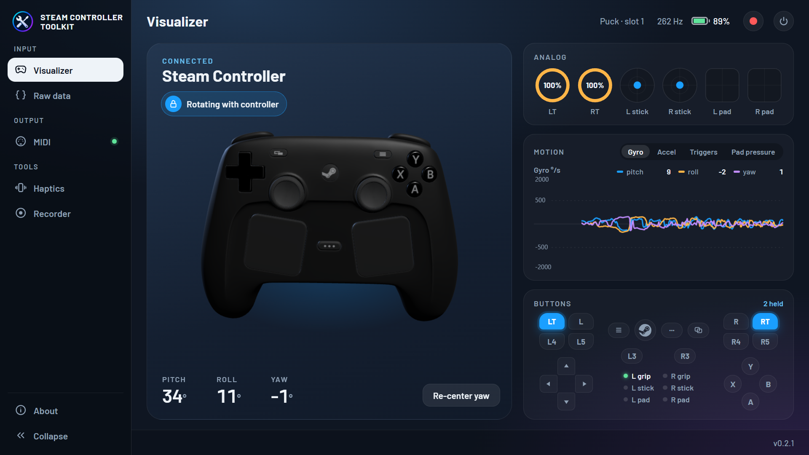
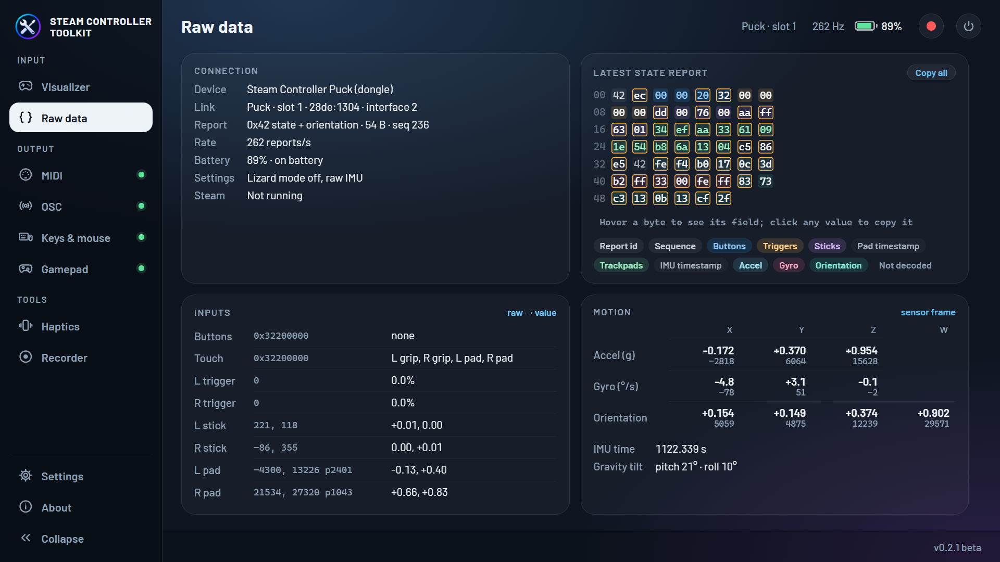
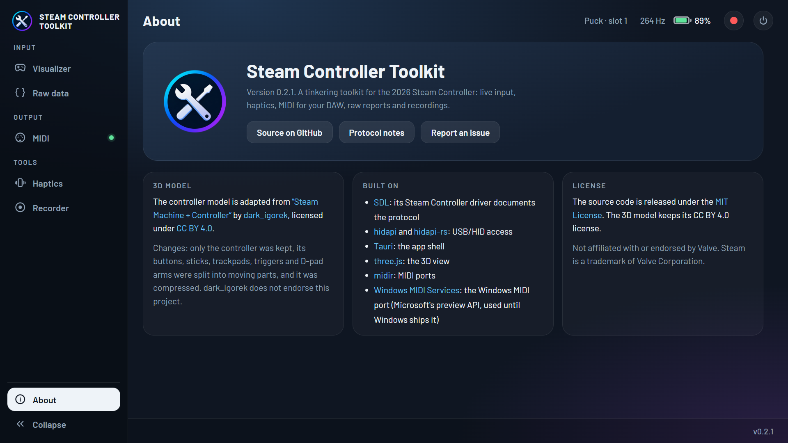

<p align="center">
  
</p>

<h1 align="center">Steam Controller Toolkit</h1>

<p align="center">
  A desktop app for exploring and tinkering with the 2026 Steam Controller.<br />
  Windows · macOS · Linux
</p>

<p align="center">
  <a href="https://www.youtube.com/watch?v=QCvgsTT6-FI">
    
  </a>
  <br />
  <sub>▶ <a href="https://www.youtube.com/watch?v=QCvgsTT6-FI">Watch the demo video on YouTube</a></sub>
</p>



## Features

The app talks to the controller directly over HID (no Steam or driver needed) and shows
everything it sends, live (~265 reports per second). It is organised in tabs, one per tool.

### Visualizer

- **3D controller** with every button, stick, trigger, trackpad, D-pad arm and back button
  moving and lighting up as you use it. The view rests front-facing; **hold the right trigger**
  (past 30%) and the model follows how you turn the controller, then eases back when you let go.
- **Pitch, roll and yaw** from the controller's own orientation sensor, with a *Re-center yaw*
  button (yaw has no absolute reference and drifts slowly).
- **Analog gauges**: trigger rings, stick positions and trackpad finger positions, with
  capacitive touch shown on the sticks and pads.
- **Motion graph**: the last 5 seconds of gyro, accelerometer, triggers or pad pressure, on
  fixed scales so past data never rescales. Hover it to read past values.
- **Buttons panel** laid out like the controller, including the L4/L5/R4/R5 back buttons and
  the grip, stick and pad touch sensors.

### Raw data



For protocol work and debugging:

- **Connection**: device, USB IDs and interface, report type and sequence, report rate,
  battery, the settings the app sends, and whether Steam is running.
- **Latest state report** as a byte map, coloured by field. Bytes light up when they change;
  hover one to see its field and value in hex, decimal and binary.
- **Inputs and motion** with each decoded value next to its raw counts: buttons and touch
  bitmasks, triggers, sticks, pads, accelerometer, gyro, orientation quaternion, IMU time and
  the tilt computed from gravity alone.
- **Undecoded reports** the app has seen, with their latest bytes.

### Everywhere

- The top bar shows the connection (e.g. *Puck · slot 1*), report rate and battery.
- **Power button**: turns the controller off (click twice to confirm).
- **Click any value to copy it**, or *Copy all* for a whole report as hex.
- A warning appears while Steam is running (see [Requirements](#requirements)).
- **About** tab with version, links and credits.



More tools (haptics, stick tester, gyro mouse) are planned. See
[docs/PROTOCOL.md](docs/PROTOCOL.md) for how the communication with the controller works.

## Requirements

- Windows, macOS or Linux. Developed and tested on Windows 11; macOS and Linux builds are
  untested.
- A 2026 Steam Controller connected through its wireless receiver ("Puck"). USB-cable and
  Bluetooth connections are recognised too but have not been tested yet.
- **Steam can stay running**, but while it runs, Steam's *Desktop Layout* turns the controller
  into a mouse and keyboard. The app shows a warning when Steam is running; close Steam or clear
  the Desktop Layout bindings if that gets in the way.
- **Linux**: your user needs access to the controller's `hidraw` devices. Steam installs a udev
  rule for this; without Steam, see [docs/PROTOCOL.md](docs/PROTOCOL.md#platform-notes).

## Download

Builds are on the [Releases](https://github.com/robinneefs/steam-controller-toolkit/releases)
page. The portable versions run without installing:

- **Windows**: `..._x64_portable.exe`. Just run it (it uses WebView2, which Windows 10/11 include).
- **macOS**: `..._macos_universal.zip`. Unzip it and open the app. The app isn't signed, so the
  first time, right-click it and choose *Open*.
- **Linux**: `..._amd64.AppImage`. Make it executable (`chmod +x`) and run it.

Installers (`.msi`/setup `.exe`, `.dmg`, `.deb`/`.rpm`) are there too if you prefer them.

## Building from source

1. Install [Rust](https://rustup.rs), [Node.js](https://nodejs.org) 20+ and the
   [Tauri prerequisites](https://tauri.app/start/prerequisites/) for your OS.
2. Install dependencies and start the app:

```bash
npm install
```

```bash
npm run tauri dev
```

To build an installer for your current OS:

```bash
npm run tauri build
```

### Checking the 3D model

With a controller connected, add `#demo` to the page URL (e.g. `location.hash = "demo"` in the
dev tools console) to make the 3D view cycle through every input, so each moving part can be
checked without pressing it yourself.

### Command-line probe

To see what the controller sends without the UI (device list, decoded reports, report rates):

```bash
npm run probe -- --raw --seconds 10
```

## Project layout

| Path | What it is |
|---|---|
| `crates/sc-core` | Rust device layer: HID discovery, configuration, report parsing, hot-plug reader threads |
| `src-tauri` | Tauri backend: runs the device layer and streams snapshots to the UI |
| `src` | TypeScript frontend: tab shell and the Visualizer, Raw data and About tabs |
| `tools/convert-model.mjs` | Builds the compact 3D model from the original Sketchfab file |
| `tools/split-dpad.py` | Headless Blender script that cuts the D-pad into four arms (run by `convert-model.mjs`) |
| `public/models` | The 3D controller model, its license and credit |
| `third_party/hidapi` | hidapi 2.6.7 with a one-line fix (see `docs/PROTOCOL.md`) |
| `docs/PROTOCOL.md` | How the app and the controller communicate |
| `docs/screenshots` | The screenshots in this README |
| `mockups/redesign.html` | Design reference for the app's look |

## Credits

- 3D controller model adapted from
  ["Steam Machine + Controller"](https://sketchfab.com/3d-models/steam-machine-controller-c1fcf77d71984c11818a5e2412816705)
  by [dark_igorek](https://sketchfab.com/dark_igorek), licensed under
  [CC BY 4.0](https://creativecommons.org/licenses/by/4.0/). We extracted the controller, split
  its inputs into moving parts and compressed it; see [`public/models/`](public/models/).
- Protocol knowledge from [SDL](https://github.com/libsdl-org/SDL)'s Steam Controller driver
  (`src/joystick/hidapi/SDL_hidapi_steam_triton.c`).
- USB/HID access via [hidapi](https://github.com/libusb/hidapi) and
  [hidapi-rs](https://github.com/ruabmbua/hidapi-rs).

## License

The source code is released under the [MIT License](LICENSE). The 3D model in `public/models/`
is licensed separately under CC BY 4.0.

Steam and Steam Controller are trademarks of Valve Corporation. This project is not affiliated
with or endorsed by Valve or the 3D model's author.
