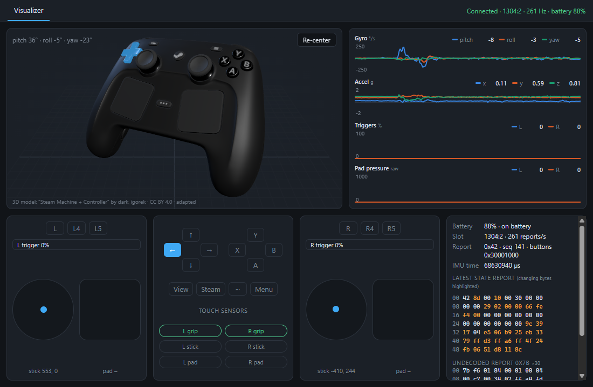

<p align="center">
  
</p>

<h1 align="center">Steam Controller Toolkit</h1>

<p align="center">
  A desktop app for exploring and tinkering with the 2026 Steam Controller.<br />
  Windows · macOS · Linux
</p>



## Features

The app is organised in tabs, one per tool. Available now:

- **Visualizer**: everything the controller sends, live (~265 reports per second):
  - textured 3D model that follows the controller's own orientation sensor, with every button,
    stick, trigger, trackpad and back button moving as you use it
  - scrolling graphs of gyro, accelerometer, triggers and trackpad pressure
  - trackpad finger position and pressure, stick positions, capacitive touch on grips, sticks
    and pads
  - battery level and charge state, report rate, and a hex view of the raw report with changing
    bytes highlighted

More tools (raw protocol explorer, haptics, stick tester, gyro mouse) are planned.

The app talks to the controller directly over HID; it does not need Steam. See
[docs/PROTOCOL.md](docs/PROTOCOL.md) for how the communication works.

## Requirements

- A 2026 Steam Controller connected through its wireless receiver ("Puck"). USB-cable and
  Bluetooth connections are recognised too but have not been tested yet.
- **Steam can stay running**, but while it runs, Steam's *Desktop Layout* turns the controller
  into a mouse and keyboard. The app shows a warning when Steam is running; close Steam or clear
  the Desktop Layout bindings if that gets in the way.
- **Linux**: your user needs access to the controller's `hidraw` devices. Steam installs a udev
  rule for this; without Steam, see [docs/PROTOCOL.md](docs/PROTOCOL.md#platform-notes).

## Building from source

1. Install [Rust](https://rustup.rs), [Node.js](https://nodejs.org) 20+ and the
   [Tauri prerequisites](https://tauri.app/start/prerequisites/) for your OS.
2. Install dependencies and start the app:

```bash
npm install
```

```bash
npm run tauri dev
```

To build an installer for your current OS:

```bash
npm run tauri build
```

### Command-line probe

To see what the controller sends without the UI (device list, decoded reports, report rates):

```bash
npm run probe -- --raw --seconds 10
```

## Project layout

| Path | What it is |
|---|---|
| `crates/sc-core` | Rust device layer: HID discovery, configuration, report parsing, hot-plug reader threads |
| `src-tauri` | Tauri backend: runs the device layer and streams snapshots to the UI |
| `src` | TypeScript frontend: tab shell and the Visualizer |
| `tools/convert-model.mjs` | Builds the compact 3D model from the original Sketchfab file (needs Blender for `tools/split-dpad.py`) |
| `third_party/hidapi` | hidapi 2.6.7 with a one-line fix (see `docs/PROTOCOL.md`) |
| `docs/PROTOCOL.md` | How the app and the controller communicate |

## Credits

- 3D controller model adapted from
  ["Steam Machine + Controller"](https://sketchfab.com/3d-models/steam-machine-controller-c1fcf77d71984c11818a5e2412816705)
  by [dark_igorek](https://sketchfab.com/dark_igorek), licensed under
  [CC BY 4.0](https://creativecommons.org/licenses/by/4.0/). We extracted the controller, split
  its inputs into moving parts and compressed it; see [`public/models/`](public/models/).
- Protocol knowledge from [SDL](https://github.com/libsdl-org/SDL)'s Steam Controller driver
  (`src/joystick/hidapi/SDL_hidapi_steam_triton.c`).
- USB/HID access via [hidapi](https://github.com/libusb/hidapi) and
  [hidapi-rs](https://github.com/ruabmbua/hidapi-rs).

## License

The source code is released under the [MIT License](LICENSE). The 3D model in `public/models/`
is licensed separately under CC BY 4.0.

Steam and Steam Controller are trademarks of Valve Corporation. This project is not affiliated
with or endorsed by Valve or the 3D model's author.
