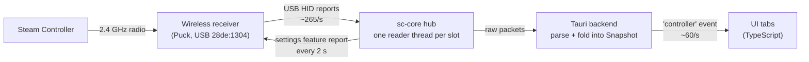

# How the app talks to the Steam Controller

This document describes how Steam Controller Toolkit finds the 2026 Steam Controller, configures
it, reads its input, and passes that input to the UI. Everything here was verified on real
hardware (wireless receiver, Windows 11) unless marked otherwise.

The controller has no public protocol documentation. Our main reference is SDL's driver for it
(`src/joystick/hidapi/SDL_hidapi_steam_triton.c` and `steam/controller_structs.h` in
[libsdl-org/SDL](https://github.com/libsdl-org/SDL)); "Triton" is the controller's codename there.

## Contents

1. [Overview](#overview)
2. [Finding the controller](#finding-the-controller)
3. [Configuring it: lizard mode and the IMU](#configuring-it-lizard-mode-and-the-imu)
4. [Input reports](#input-reports)
5. [Other reports](#other-reports)
6. [Haptics](#haptics)
7. [Reading reports reliably](#reading-reports-reliably)
8. [From reports to the UI](#from-reports-to-the-ui)
9. [Interaction with Steam](#interaction-with-steam)
10. [Platform notes](#platform-notes)

## Overview



- **`crates/sc-core`** is the device layer and knows nothing about the UI: discovery
  (`device.rs`), the wire format (`protocol.rs`) and the background readers (`hub.rs`).
- **`src-tauri`** runs the hub, parses packets, keeps the latest state and emits it to the
  window as a `controller` event about 60 times a second.
- **`src/`** is the UI. `src/controller.ts` mirrors the Rust types.
- **`crates/sc-core/examples/probe.rs`** (`npm run probe`) prints the same data in a terminal.

The controller speaks plain USB HID with vendor-defined reports, so no driver is needed. We use
[hidapi](https://github.com/libusb/hidapi) through the `hidapi` Rust crate.

## Finding the controller

### USB IDs

All Valve devices use vendor ID **`0x28DE`**.

| Product ID | Connection | Status |
|---|---|---|
| `0x1304` | Wireless receiver "Steam Controller Puck" (Proteus) | tested |
| `0x1305` | Newer wireless receiver (Nereid) | from SDL, untested |
| `0x1302` | Controller on a USB cable | from SDL, untested |
| `0x1303` | Controller over Bluetooth LE | from SDL, untested |

### Interfaces and collections

The receiver is a composite USB device. It exposes **interfaces 2, 3, 4 and 5 as four
controller slots** (one per paired controller), plus a serial port (interface 0) and another
vendor interface (6).

Each slot interface carries three HID *collections*: a mouse, a keyboard (both used by lizard
mode, see below) and a **vendor-defined collection (usage page `0xFF00`)** that carries the
controller's raw reports. On Windows each collection appears as a separate HID device, so we
pick the one whose usage page is `0xFF00`; on other platforms hidapi reports usage page 0 and
the whole interface is one device. See `device::is_controller_interface`.

On our receiver, the paired controller reported on **interface 2**. The other slots open
successfully but stay silent until a second controller pairs.

### Enumerate only Valve devices

hidapi's unfiltered enumeration asks *every* HID device on the system for its manufacturer,
product and serial strings. On Windows, a device that stops answering makes that call block
forever. We hit this with a Corsair device (`1b1c:1b3a`) hanging in
`HidD_GetSerialNumberString`, which froze discovery entirely.

So we only ever enumerate vendor `0x28DE` (`device::valve_api()` / `device::rescan()`), and
hidapi only queries strings for devices whose IDs match. hidapi-rs's `HidApi::new()` always
did a full scan, even with discovery disabled, so `third_party/hidapi` carries a one-line patch
that skips it. The patch is wired in through `[patch.crates-io]` in the root `Cargo.toml`.

## Configuring it: lizard mode and the IMU

Out of the box the controller runs in **lizard mode**: its firmware emulates a mouse (right
trackpad) and a keyboard, so it is usable on a desktop without Steam. It also does not send
gyro and accelerometer data. We change both with a **settings feature report**:

| Byte | Value | Meaning |
|---|---|---|
| 0 | `0x01` | HID report ID |
| 1 | `0x87` | message type `ID_SET_SETTINGS_VALUES` |
| 2 | `6` | payload length: two settings of 3 bytes |
| 3 | `9` | setting `SETTING_LIZARD_MODE` |
| 4–5 | `0x0000` (LE) | `LIZARD_MODE_OFF` |
| 6 | `48` | setting `SETTING_IMU_MODE` |
| 7–8 | `0x0018` (LE) | `SEND_RAW_ACCEL (0x08) \| SEND_RAW_GYRO (0x10)` |
| 9–63 | `0` | padding: the report is always 64 bytes |

Each setting is a `u8` setting number followed by a little-endian `u16` value; one message can
carry up to 20.

Two rules, both learned the hard way:

- **Resend it every 2 seconds.** The firmware has a watchdog that turns lizard mode back on
  after about 3 seconds without a host refresh. That way the controller works as a mouse
  again as soon as the app quits. See `Controller::keep_configured`.
- **Only configure a slot after a controller in it has sent a state report** (or a
  "connected" wireless status). Sending settings to an empty receiver slot fails every time
  (`HidD_SetFeature`: "device not functioning"), and doing that every 2 seconds on three slots
  coincided with the receiver dropping its slots until it was replugged. SDL behaves the same
  way. See `hub::read_loop`.

### Turning the controller off

The app's power button sends one more feature report, `protocol::turn_off_report()`:

| Byte | Value | Meaning |
|---|---|---|
| 0 | `0x01` | report id |
| 1 | `0x9F` | message type `ID_TURN_OFF_CONTROLLER` (SDL `controller_constants.h`) |
| 2 | `4` | payload length |
| 3..7 | `off!` | magic the original Steam Controller expects |

SDL's driver for this controller never sends it, but the 2026 controller honours it (verified
over the Puck dongle). Commands reach a controller through its interface's reader thread: the
app calls `hub::Hub::send(slot, Command::TurnOff { .. })`, and `read_loop` runs it between reads.

## Input reports

Input reports arrive on the vendor collection. **Byte 0 is the report ID**, all multi-byte
fields are **little-endian**, and structures are packed (no padding).

| ID | Name | Length | Notes |
|---|---|---|---|
| `0x42` | State | 54 bytes | What our controller sends: full state plus orientation quaternion |
| `0x45` | State, no quaternion | 46 bytes | Same layout without the quaternion (BLE) |
| `0x47` | State, with timestamps | 46 bytes | Adds a trackpad timestamp; 16-bit IMU timestamp |
| `0x43` | Battery | | see [Other reports](#other-reports) |
| `0x79`, `0x46` | Wireless status | | controller connected/disconnected on this slot |
| `0x7b` | *Unknown* | 54 bytes | About 2 per second; not decoded yet (the Raw data tab shows its bytes) |

### State report `0x42` / `0x45`

| Offset | Type | Field | Range and meaning |
|---|---|---|---|
| 0 | u8 | report ID | `0x42` or `0x45` |
| 1 | u8 | sequence | increments every report, wraps at 255 |
| 2 | u32 | buttons | bitmask, see below |
| 6 | i16 | left trigger | 0 (released) … 32767 (fully pulled) |
| 8 | i16 | right trigger | same |
| 10 | i16 | left stick X | −32768 … 32767, + is right |
| 12 | i16 | left stick Y | + is up (away from you) |
| 14 | i16 | right stick X | |
| 16 | i16 | right stick Y | |
| 18 | i16 | left pad X | −32768 … 32767, + is right; valid while touched |
| 20 | i16 | left pad Y | + is up |
| 22 | u16 | left pad pressure | 0 when not pressed |
| 24 | i16 | right pad X | |
| 26 | i16 | right pad Y | |
| 28 | u16 | right pad pressure | |
| 30 | u32 | IMU timestamp | microseconds |
| 34 | i16 ×3 | accelerometer X, Y, Z | ±2 g full scale: **16384 = 1 g** |
| 40 | i16 ×3 | gyroscope X, Y, Z | ±2000 °/s full scale: **16.384 per °/s** |
| 46 | i16 ×4 | quaternion W, X, Y, Z | **`0x42` only**; 32767 = 1.0 |

Report `0x47` is identical up to offset 17, then inserts a `u16` trackpad timestamp at offset
18, which shifts the pads to offsets 20–31. Its IMU timestamp is a `u16` at offset 32 (units of
32 µs), so the accelerometer and gyro land at the same offsets (34, 40) as above.

A captured `0x42` report, controller lying still:

```
00  42 bb 00 00 00 00 00 00   id, seq, buttons, triggers
08  00 00 ba 01 8d 00 51 fe   …, left stick 442,141, right stick X -431
16  58 00 00 00 00 00 00 00   right stick Y 88, pads untouched
24  00 00 00 00 00 00 4f c0   …, IMU timestamp 0x000cc04f
32  0c 00 00 00 a2 31 6e 25   accel 0, 12706, 9582  (|a| ≈ 0.99 g)
40  e0 ff fd ff 04 00 12 6f   gyro -32, -3, 4; quaternion W 0x6f12
48  07 32 f1 ef 29 dc         quaternion X, Y, Z
```

Resting sticks read a few hundred counts off centre; apply a dead zone before treating them as
deflected.

### Buttons bitmask (offset 2)

| Bit | Mask | Input | | Bit | Mask | Input |
|---|---|---|---|---|---|---|
| 0 | `0x00000001` | A | | 15 | `0x00008000` | L3 (left stick click) |
| 1 | `0x00000002` | B | | 16 | `0x00010000` | Steam |
| 2 | `0x00000004` | X | | 17 | `0x00020000` | L4 (upper left back) |
| 3 | `0x00000008` | Y | | 18 | `0x00040000` | L5 (lower left back) |
| 4 | `0x00000010` | Quick Access (···) | | 19 | `0x00080000` | L bumper |
| 5 | `0x00000020` | R3 (right stick click) | | 20 | `0x00100000` | right stick touched |
| 6 | `0x00000040` | Menu (≡, right of the Steam button) | | 21 | `0x00200000` | right pad touched |
| 7 | `0x00000080` | R4 (upper right back) | | 22 | `0x00400000` | right pad clicked |
| 8 | `0x00000100` | R5 (lower right back) | | 23 | `0x00800000` | right trigger click (full pull) |
| 9 | `0x00000200` | R bumper | | 24 | `0x01000000` | left stick touched |
| 10 | `0x00000400` | D-pad down | | 25 | `0x02000000` | left pad touched |
| 11 | `0x00000800` | D-pad right | | 26 | `0x04000000` | left pad clicked |
| 12 | `0x00001000` | D-pad left | | 27 | `0x08000000` | left trigger click (full pull) |
| 13 | `0x00002000` | D-pad up | | 28 | `0x10000000` | right grip touched |
| 14 | `0x00004000` | View (two squares, left of the Steam button) | | 29 | `0x20000000` | left grip touched |

"Touched" bits come from capacitive sensors: they report a finger resting on the part without
pressing it.

### Motion sensors and orientation

The sensor axes, with the controller held normally:

- **+X**: to the right
- **+Y**: forward, away from you (towards the triggers)
- **+Z**: up, out of the face

At rest the accelerometer reads the reaction to gravity: about +16384 on Z when the controller
lies flat.

The **quaternion** in report `0x42` is the controller's own sensor-fusion result. It rotates
vectors from the sensor frame into a world frame whose **+Z points up**. We checked this by
rotating the accelerometer reading of the captured report above with its quaternion, which
gives ≈ (0.05, 0.06, 0.97) g, i.e. straight up. Tilt (pitch and roll) is therefore absolute.
**Yaw has no absolute reference** (there is no magnetometer) and slowly drifts, so the 3D view
has a *Re-center yaw* button that zeroes it for its angle readout.

Three.js uses +Y up and +Z towards the viewer, so the 3D view maps `(x, y, z) → (x, z, −y)` for
both vectors and the quaternion's vector part (`src/tabs/controller3d.ts`).

## Other reports

**Battery `0x43`**, sent occasionally:

| Offset | Type | Field |
|---|---|---|
| 1 | u8 | charge state: 0 reset, 1 on battery, 2 charging, 3 validating source, 4 fully charged |
| 2 | u8 | battery level, % |
| 3 | u16 | battery voltage |
| 5 | u16 | system voltage |
| 7 | u16 | input voltage |
| 9 | u16 | current |
| 11 | u16 | input current |
| 13 | u16 | temperature |

The app currently uses only the charge state and level; the other fields' units are not
documented.

**Wireless status `0x79` / `0x46`**: byte 1 is `2` when a controller connects to the slot and
`1` when it disconnects.

**Haptics**: output reports `0x80`–`0x85` drive the two haptic motors; see
[Haptics](#haptics).

## Haptics

Haptic effects are **output reports** (written with `hid_write`, not feature reports), from
`ID_OUT_REPORT_HAPTIC_*` in SDL's `controller_structs.h`. All six play on the controller
(verified over the Puck; `cargo run -p sc-core --example haptics` measures each one with the
accelerometer). They are built by `protocol::haptic_report()` from a `protocol::Haptic` and sent
with `Command::Haptic`.

The actuators sit under the trackpads. `side` picks them: `0` left, `1` right, `2` both; `3` and
up play nothing. (Checked by hand with `--example haptics -- --buzz N click`, with the controller
on a table and a thumb on each trackpad. Held by the grips, the whole shell buzzes and every
side feels like both.) `gain_db` is a signed byte in dB, 0 = full strength.

| Id | Effect | Payload after the id (packed, little-endian) |
|---|---|---|
| `0x80` | Rumble | `type u8, intensity u16, left_speed u16, left_gain i8, right_speed u16, right_gain i8` |
| `0x81` | Pulse train | `side u8, on_us u16, off_us u16, repeat_count u16` |
| `0x82` | Built-in effect | `side u8, command u8, gain_db i8`; command 0 off, 1 tick, 2 click, 3 tone, 4 rumble, 5 noise, 6 script, 7 sweep. Only tick and click play |
| `0x83` | Tone | `side u8, gain_db i8, frequency u16, duration_ms u16, lfo_freq u16, lfo_depth u8` |
| `0x84` | Log sweep | `side u8, gain_db i8, duration_ms u16, start_hz u16, end_hz u16` |
| `0x85` | Script | `side u8, script_id u8, gain_db i8`; scripts 0..=17 play, 18 and up are empty |

Rumble is a gamepad-style effect for both motors at once; like SDL we send `type`, `intensity`
and the gains as 0. The controller stops a rumble about 50 ms after the last report, so the
interface's reader thread resends the current one every 40 ms until a rumble with both speeds 0
arrives (`hub::read_loop`).

## Reading reports reliably

The controller sends about **265 state reports per second** (one every ~3.8 ms; the USB
descriptor claims 1 kHz).

Our first probe polled the four receiver slots in turn with a 2 ms read timeout and received
only **26 reports per second**. The sequence numbers showed the other 90% were lost. On Windows
a read timeout lasts at least one scheduler tick (~15.6 ms), so each pass over the three silent
slots wasted ~45 ms.

The fix is **one blocking reader thread per interface** (`hub.rs`), each waiting up to 500 ms
for its next report and forwarding it over a channel. That receives all ~265 reports per
second. The hub also re-enumerates every 2 seconds and opens new interfaces, so unplugging and
replugging the receiver works without restarting the app.

## From reports to the UI

The backend (`src-tauri/src/lib.rs`) parses every packet and keeps a `Snapshot`: the latest
state, battery, report rate, raw bytes, and any undecoded report IDs. It emits it to the window
as the `controller` event every 16 ms (~60 per second), which is as fast as the screen can show
it. The frontend redraws only what changed. The 3D view skips frames when neither the
orientation nor any input has moved, and nothing is drawn while the window is hidden.

## Interaction with Steam

Reading works while Steam is running, but Steam reads the controller too. Its **Desktop
Layout** then turns controller input into mouse and keyboard input, independently of lizard
mode, so the app cannot switch it off. The backend checks for a running Steam process every
3 seconds, and the UI shows a warning with the two ways to stop it: close Steam, or clear the
Desktop Layout bindings in Steam → Settings → Controller.

## Platform notes

- **Windows**: works as is; no driver or admin rights needed.
- **Linux** (untested): the app needs read/write access to the controller's `/dev/hidraw*`
  nodes. Steam's `steam-devices` package installs suitable udev rules, and so do the app's .deb
  and .rpm (`src-tauri/linux/60-steam-controller-toolkit.rules`, which also opens `/dev/uinput`
  for the keyboard & mouse and gamepad outputs). Without either, put this in
  `/etc/udev/rules.d/60-steam-controller-toolkit.rules`, then run
  `sudo udevadm control --reload && sudo udevadm trigger` (or replug) to grant the signed-in user
  access:

  ```
  KERNEL=="hidraw*", ATTRS{idVendor}=="28de", MODE="0660", TAG+="uaccess"
  KERNEL=="hidraw*", KERNELS=="*28DE:*", MODE="0660", TAG+="uaccess"
  KERNEL=="uinput", SUBSYSTEM=="misc", OPTIONS+="static_node=uinput", TAG+="uaccess"
  ```

  Linux 7.3 and later also ship a `hid-steam` kernel driver for this controller, which may
  disable lizard mode itself.
- **macOS** (untested): the first access may trigger an *Input Monitoring* permission prompt.
